# verano-phishguard

**Chrome extension (Manifest V3) that detects phishing pages in real time, entirely inside the browser.**

Author: @alex_mh · Part of the [TrifoldPathSec](https://github.com/TrifoldPathSec) home-lab portfolio

---

## What it does

Verano checks every page you visit **twice**. First it checks the address before the page loads. Then it checks the page itself once it renders, and again if a login form appears later. Each page gets a **0–100 risk score** and one of three verdicts: *safe*, *suspicious* or *phishing*.

```
 you click a link
       │
       ▼
 service worker ── webNavigation.onBeforeNavigate ──▶ URL rules ──┐
       │                                                          │ phishing?
       │                                                          ├──▶ full-page warning (page never loads)
       ▼                                                          │
 page loads ── content script ── DOM snapshot ──▶ page rules ─────┤ suspicious?
       │            ▲                                             ├──▶ in-page banner + toolbar badge
       │            └── MutationObserver: login form injected later? re-scan
       ▼
 user hits "Log in" on a flagged page ──▶ submit guard: "Hold on before you sign in"
```

- **Zero network calls.** No URL, page content or keystroke ever leaves the browser. There's no API key, no telemetry and no remote blocklist.
- **Minimal permissions.** `storage` and `webNavigation`, plus host access so the content script can read pages. There's no `tabs`, `cookies`, `webRequest` or `scripting`.
- **Never reads what you type.** The collector records *that* a password or card field exists, never its value.
- **Shadow-DOM UI.** The banner and dialogs sit in a closed shadow root, so a phishing page's CSS or JS can't hide or restyle them.

## Screenshots

All screenshots come from Chrome 155 with the unpacked extension and the local demo pages (see [Try it](#try-it)).

### Blocked before the page loads

| Brand login posting to a raw IP (100) | Wallet seed-phrase harvester (85) |
|---|---|
| 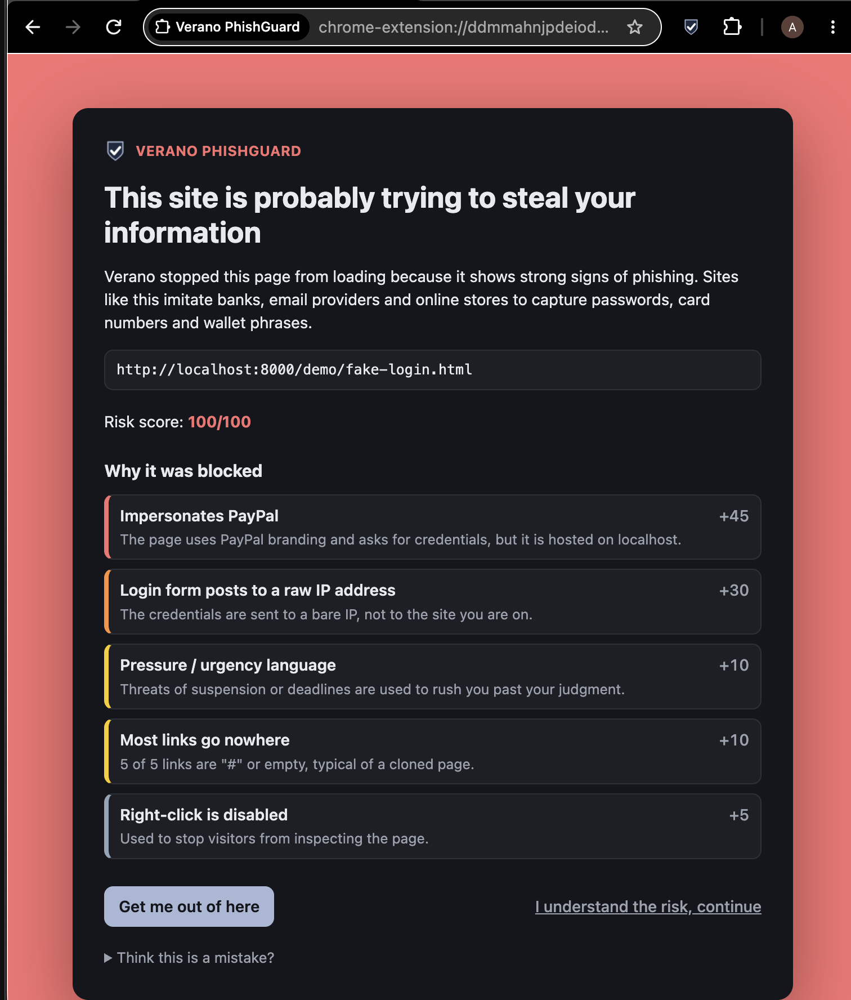 | 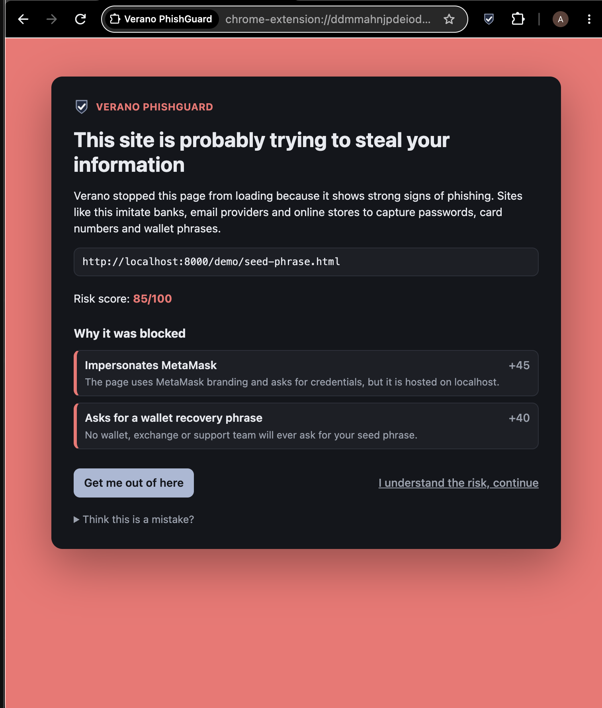 |

| Login form injected 2 s after load, caught on re-scan (80) | Toolbar popup on a flagged page |
|---|---|
| 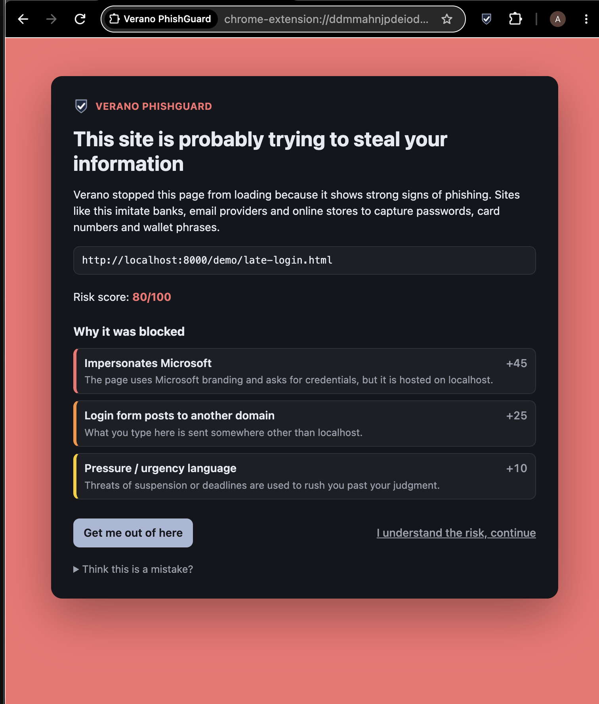 | 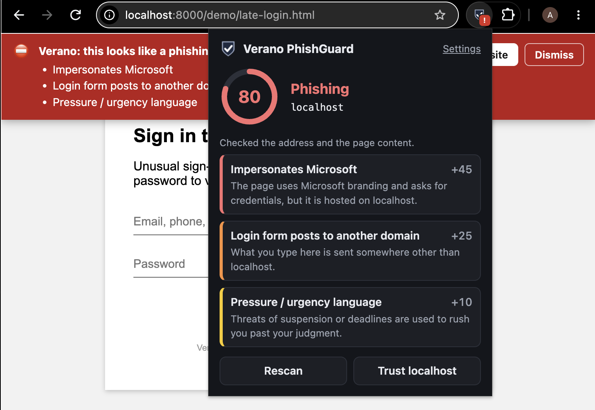 |

### URL tricks, scored from the address alone

| Unicode homograph: `xn--pypal-4ve.com` renders as "pаypal.com" (100) | Fake brand before "@" hides the real host (95) |
|---|---|
| 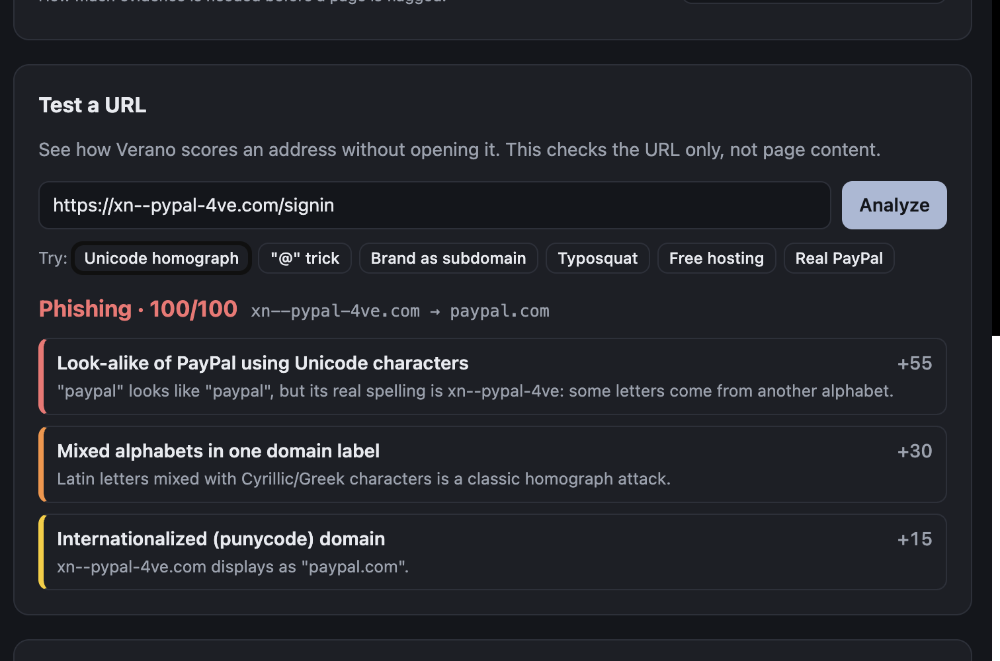 | 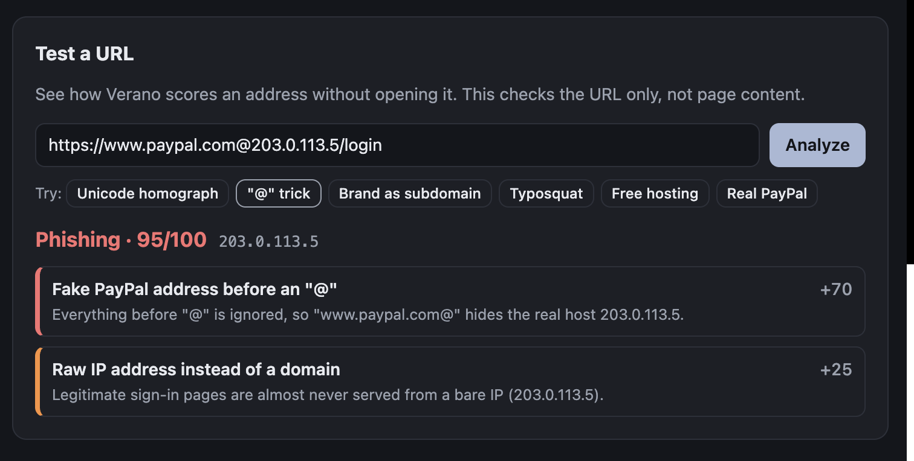 |

### If the user continues anyway

| Banner stays on the page | Submit guard stops the password from being sent |
|---|---|
| 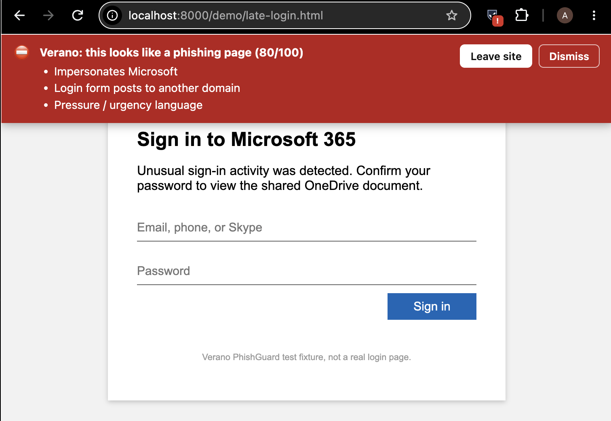 | 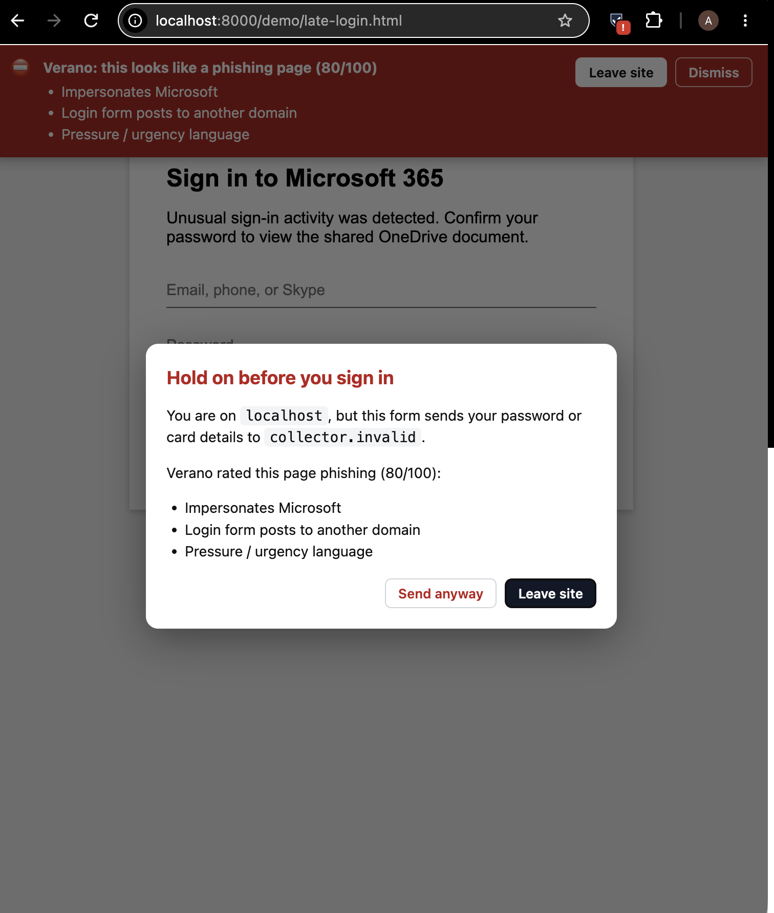 |

### No false alarms, and a full log

| Ordinary article that mentions PayPal (0) | Real PayPal address in the URL tester | Detection history |
|---|---|---|
| 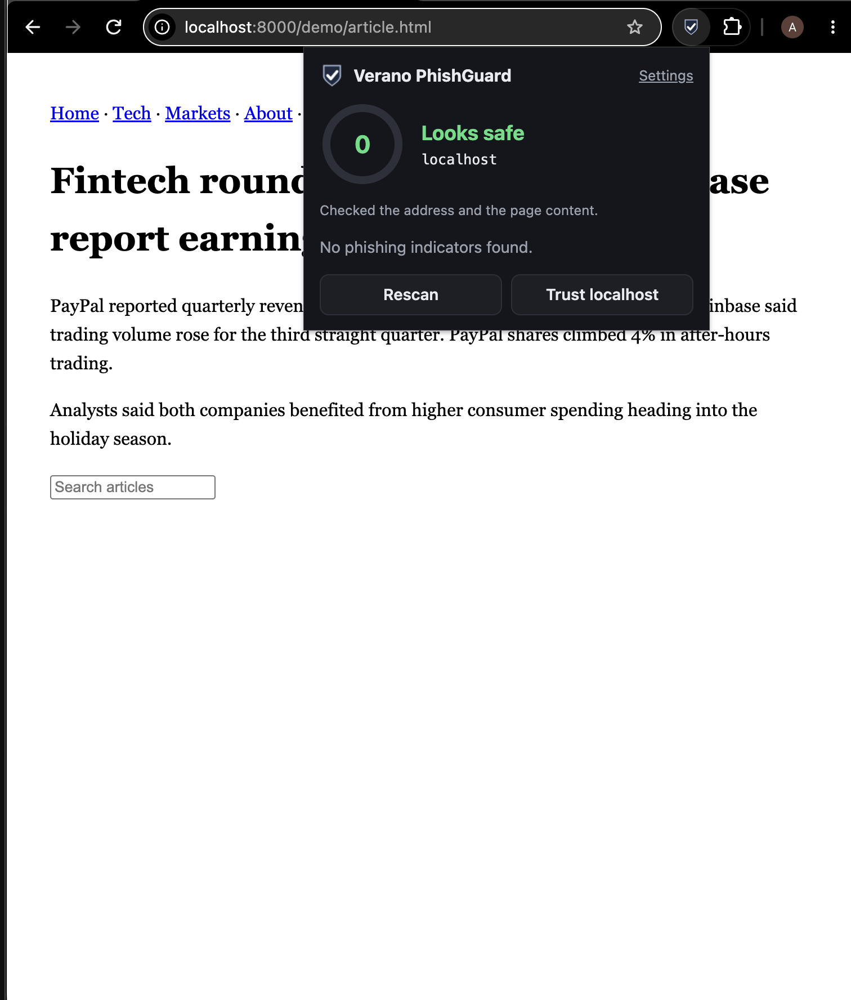 | 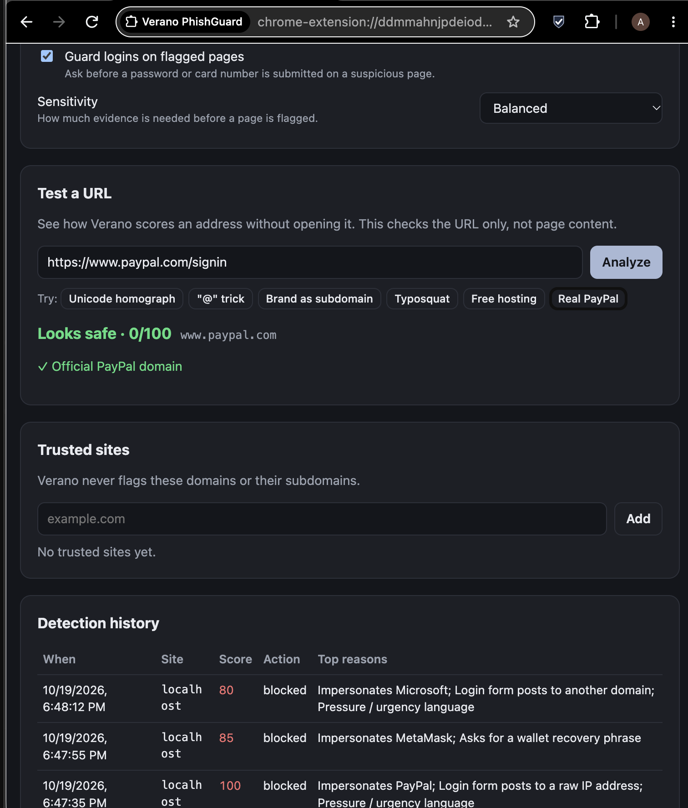 | 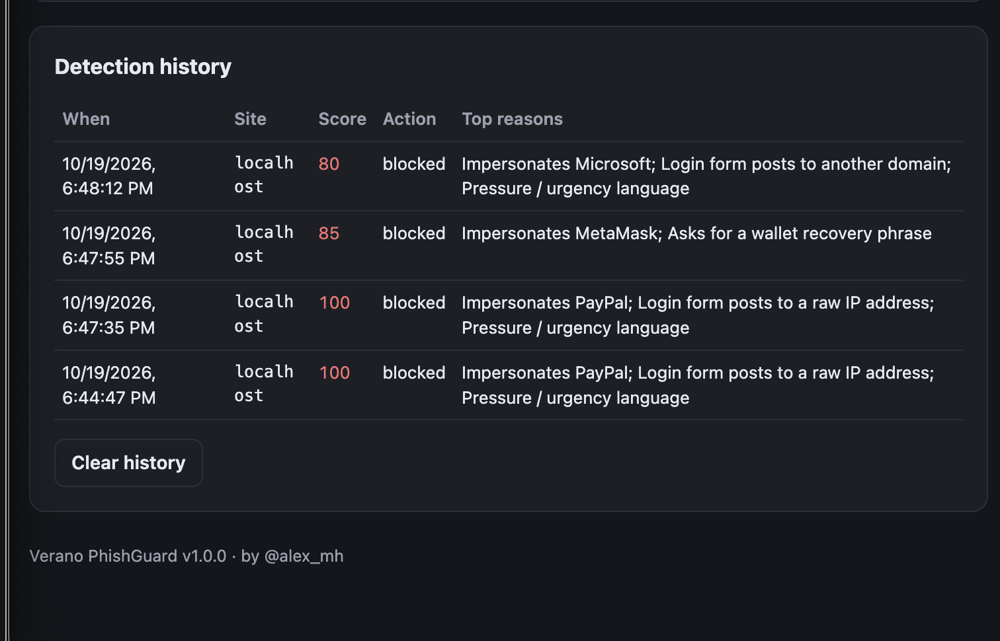 |

## Detection rules

### URL rules (before the page loads)

| Rule | Weight | Example |
|---|---|---|
| Fake brand address before `@` | 70 | `https://www.paypal.com@203.0.113.5/login` |
| Unicode homograph of a brand | 55 | `xn--pypal-4ve.com` → `pаypal.com` (Cyrillic **а**) |
| Brand domain used as a subdomain | 50 | `paypal.com.secure-login.example` |
| Typosquat (leet, `rn`→`m`, 1–2 char edits) | 45 | `paypa1-secure.example`, `arnazon.example`, `micros0ft-online.example` |
| Obfuscated IP host | 40 | `http://3232235777/` (decimal for 192.168.1.1) |
| Look-alike brand in a subdomain | 40 | `paypa1.account.example` |
| Mixed alphabets in one label | 30 | Latin + Cyrillic/Greek/Armenian |
| Brand name in a subdomain | 30 | `apple.account-check.example` |
| Raw IP address host | 25 | `http://192.0.2.10/login.php` |
| Brand name inside an unrelated domain | 25 | `amazon-account-verify.web.app` |
| Brand name in the path | 20 | `http://192.0.2.10/paypal/login.php` |
| Punycode domain · free hosting platform · deep subdomains | 10–15 | `*.web.app`, `*.pages.dev`, `*.ngrok-free.app`, … |
| Account/security words in host · high-abuse TLD · many hyphens · random label · odd port | 10–15 | `secure-login-verify.top` |
| HTTP · shortener · embedded redirect · very long URL | 5 | |

### Page rules (after the page renders)

| Rule | Weight | What it looks for |
|---|---|---|
| Brand impersonation | 45 | Title, headings, logo alt/filenames or form text claim a brand **and** the page asks for secrets **and** the domain isn't the brand's |
| Wallet seed-phrase request | 40 | 12+ word boxes or a textarea next to "recovery phrase" / "seed phrase" |
| Form posts to a raw IP | 30 | `<form action="http://198.51.100.7/…">` on a password form |
| Password on plain HTTP | 30 | Password field on a non-TLS page (localhost exempt) |
| Form posts to another domain | 25 | Credentials sent somewhere other than the page's own domain |
| Secure page submits over HTTP | 20 | HTTPS page, HTTP form action |
| Brand mentioned next to a login | 20 | Weaker version of impersonation, from body text only |
| Brand assets hot-linked | 15 | Logos/CSS pulled from the real brand's CDN onto a login page |
| Card harvesting | 15 | Card/CVV fields on a brand-impersonating or HTTP page |
| Urgency language · dead links · meta-refresh away | 10 | "account has been limited", "within 24 hours", 80 %+ `#` links |
| Right-click disabled · hidden iframe | 5 | |

**Scoring.** Weights add up and are capped at 100. *Balanced* sensitivity flags ≥ 40 as suspicious and ≥ 70 as phishing. *Strict* uses 30/60 and *Relaxed* uses 50/80.

**False-positive controls.** Domains a brand really owns (35 brands, ~150 domains) are trusted outright, as is your own trusted-sites list. Only the single strongest brand finding counts. Known real names that look like typos are ignored (`paypay`, `finance`). Short tokens such as `ups` and `irs` must match a whole hyphen-separated word, so `groups.example` doesn't trip the UPS rule.

## Install (unpacked)

1. Clone or download this repository.
2. Open `chrome://extensions` and switch on **Developer mode** (top right).
3. Click **Load unpacked** and pick the `verano-phishguard` folder (the one containing `manifest.json`).
4. Pin **Verano PhishGuard** from the puzzle-piece menu so the badge is visible.

Works in Chrome, Edge, Brave and other Chromium browsers (version 116 or later).

## Try it

```bash
python3 -m http.server 8000
```

Run that from the repo root, then open <http://localhost:8000/demo/>:

| Demo page | Technique | Expected | Score |
|---|---|---|---|
| `fake-login.html` | Brand login posting to a TEST-NET IP, urgency banner, dead links, right-click blocked | blocked | 100 |
| `late-login.html` | Harmless "verifying your browser…" screen, then a Microsoft 365 form injected after 2 s | blocked after the form appears | 80 |
| `seed-phrase.html` | MetaMask "restore wallet" with 12 word boxes | blocked | 85 |
| `article.html` | News article that mentions PayPal and Coinbase but asks for nothing | no warning | 0 |

Every fixture posts to an RFC 5737 documentation IP or a `.invalid` domain, so nothing typed there goes anywhere.

URL tricks like homographs and `@` addresses can't be served from `localhost`. To see them, open **Settings → Test a URL** and use the example buttons.

## Tests

```bash
./scripts/test.sh
```

41 engine tests cover punycode decoding, host splitting, every URL rule, the page rules, the allowlist and sensitivity. The tests include safe sites that must *not* be flagged: real brand logins, `applebees.com`, `paypay.ne.jp`, `finance.yahoo.com`, GitHub Pages and news articles. They run under Node if it's installed, and otherwise under the JavaScriptCore shell that ships with macOS, so there's nothing to install.

`tests/collector-harness.html` runs the real DOM collector and the engine against the demo pages in an ordinary browser tab, without the extension installed. To use it, serve the repo and open `/tests/collector-harness.html`.

## Project layout

```
manifest.json
src/
  engine/            pure detection logic, shared by worker, content script and tests
    punycode.js      RFC 3492 decoder (xn-- → Unicode)
    domain.js        URL parsing, registrable domain, IP forms, homoglyph skeletons, edit distance
    brands.js        35 commonly impersonated brands: owned domains, tokens, page keywords
    url-rules.js     pre-navigation checks
    page-rules.js    DOM-snapshot checks
    scorer.js        combine → score, verdict, trust short-circuit
  background/service-worker.js   navigation hooks, blocking, badge, history, messaging
  content/collector.js           DOM → JSON snapshot (read-only)
  content/content.js             re-scan observer, banner, submit guard
  ui/                            popup, warning interstitial, settings page
demo/                            local phishing fixtures
tests/                           engine tests + in-browser collector harness
scripts/                         test runner, icon generator (stdlib Python)
```

## Limitations

- **Heuristic, not a blocklist.** A carefully built page on a clean, unbranded domain that impersonates a brand outside the list can score low. Tune with the *Strict* setting or extend `brands.js`.
- **JS-only logins.** The submit guard catches real `<form>` submits. A kit that sends credentials with `fetch()` on a keystroke bypasses the guard, but the banner and the block still apply.
- **The URL-stage block is a redirect.** On a very fast connection, the first bytes of a phishing page can start loading before the warning replaces it. Nothing is rendered long enough to interact with.
- **No phishing in iframes.** Only top-level pages are scanned.

## Roadmap

- Optional, opt-in threat-intel lookups (Google Safe Browsing v5 hash-prefix API, so URLs stay private)
- Visual logo matching (perceptual hash of favicons vs. brand icons)
- Export detections as JSON for a Wazuh `<localfile>`, to tie in with [sharrowkyn-phishing-analyzer](https://github.com/TrifoldPathSec/sharrowkyn-phishing-analyzer)

## License

MIT, see [LICENSE](LICENSE).
